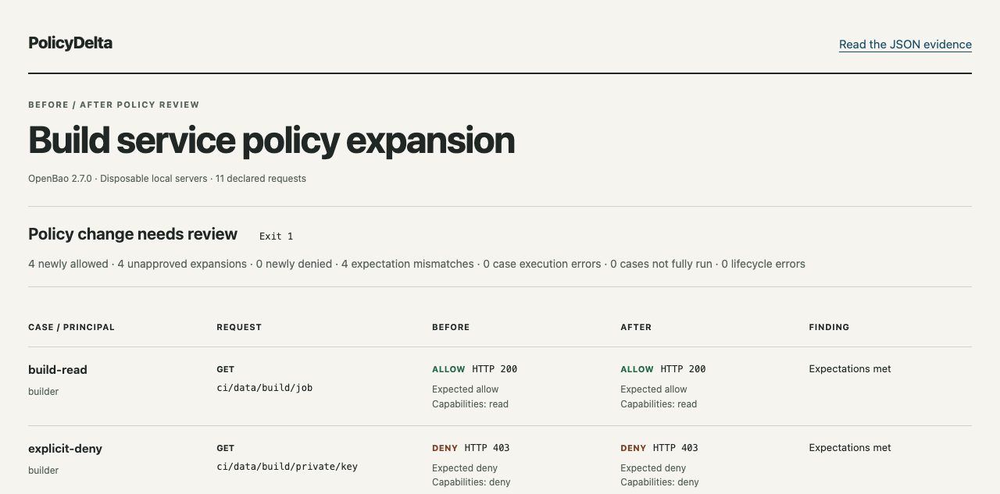

# PolicyDelta

Test an OpenBao policy change by sending the same requests before and after it. PolicyDelta starts disposable local servers, loads synthetic fixtures, and produces request-by-request HTML, JSON, and JUnit XML comparisons.

A capability list can say `update` while a parameter restriction still denies the request. The included example removes a required parameter and broadens a path. It detects four newly allowed requests, including two whose capability lists never change.

| Synthetic request | Before | After | What the capability list misses |
| --- | --- | --- | --- |
| `forbidden-parameter` | Denied (403) | Allowed (204) | `create, update` on both sides |
| `missing-parameter` | Denied (403) | Allowed (204) | `create, update` on both sides |
| `write-remains-denied` | Denied (403) | Denied (403) | No access change |

These rows come from the included [current 11-case OpenBao report](docs/current-example/report.json). Its four unapproved expansions make the example exit 1; the table highlights the two that a capability-only comparison would miss.



*Actual report generated by the installed 0.2.2.dev0 candidate: execution completed, with four unapproved expansions requiring review. [Phone capture, with the focused table panned right](docs/images/current-report-phone-0.2.2-dev.png) · [Capture provenance and reproduction](docs/captures.md).*

[View the current recorded example](https://nazeeh111.github.io/PolicyDelta/current/)
without installing anything. It shows retained synthetic results, with JSON and
JUnit evidence; it does not evaluate policies in your browser. You can also open
[the current HTML](docs/current-example/index.html) from this checkout with its
evidence files beside it. The [original historical demo](https://nazeeh111.github.io/PolicyDelta/)
and [historical source report](docs/example/report.json) remain unchanged.
Rerun the suite below to test your current local runtime.

## Try the example

Current source is the unreleased **0.2.2.dev0** development version. Historical releases and the recorded example retain their own source and evidence; they are not rebuilt artifacts of this checkout.

Use Python 3.11 or newer on macOS arm64 or Linux amd64. No Python runtime dependencies, account or API key. From this checkout:

```sh
python3 -m venv .venv
. .venv/bin/activate
python -m pip install .
python scripts/fetch_runtime.py
policy-delta examples/expansion.json --bao .runtime/bao --output review-expansion
```

The example exits **1**, intentionally: four requests gain access without approval. The CLI leads with the verdict and exit code, distinguishes unapproved expansions, then lists all three report paths. Open `review-expansion/index.html` to compare results, inspect `report.json`, or upload `junit.xml` to a CI service that accepts JUnit reports. The runtime helper downloads the pinned OpenBao 2.7.0 archive, verifies its SHA-256, and retains its license. You can instead pass your own OpenBao 2.7.0 executable with `--bao`.

```sh
# Same policy on both sides: exit 0.
policy-delta examples/unchanged.json --bao .runtime/bao --output review-unchanged

# The same four expansions explicitly approved in their named cases: exit 0.
policy-delta examples/approved.json --bao .runtime/bao --output review-approved
```

Each output directory must be new, with an existing parent. Existing reports and inputs are never overwritten. Once the suite is validated, controlled runtime failures also produce all three reports and exit **2**. Completed observations are retained; unattempted observations are **not run**, never denied. A completed run can still exit 1: completed describes execution, while the exit code gives the policy verdict. Input errors, output collisions and report-publication failures may leave no new report. Use the three artifacts after the command finishes. A write failure triggers cleanup of an incomplete set, but forced termination or cleanup failure can leave partial files.

A case interrupted after it starts is an `observation_incomplete` error, not
`not_run`: its request might already have been sent, so no outcome is invented.

For example, passing an unavailable executable now leaves a useful failed-run artifact:

```sh
policy-delta examples/unchanged.json --bao /unavailable/bao --output review-incomplete
```

`report.json` records an unverified engine, `engine_version` failure stage and
`version_check_failed` code. It contains no invented request decisions. A failure
after the first revision similarly preserves its real observations. Interrupting
execution requests owned-process cleanup before publishing the incomplete result.

The [current JSON report](docs/current-example/report.json), [portable HTML view](docs/current-example/index.html), and [JUnit XML](docs/current-example/junit.xml) retain the installed candidate's synthetic OpenBao 2.7.0 run. The earlier [historical JSON](docs/example/report.json), [HTML](docs/example/index.html) and [JUnit](docs/example/junit.xml) remain available with their original evidence.

## Write a suite

Start with [examples/expansion.json](examples/expansion.json). A suite contains:

- **Mounts:** synthetic key-value fixtures, using KV version 1 or 2.
- **Policies:** local HCL files for `before` and `after`, contained within the suite directory.
- **Principals:** named collections of policies, used to create short-lived tokens without a default policy.
- **Cases:** a principal, HTTP method, API path, optional POST body, and expected `allow` or `deny` for each revision.

For example, a named case can verify that production writes stay denied:

```json
{
  "id": "production-write",
  "principal": "builder",
  "method": "POST",
  "path": "legacy/release",
  "body": {"stage": "prod", "value": "synthetic"},
  "expect": {"before": "deny", "after": "deny"}
}
```

If an expansion is intended, set that case's `expect.after` to `allow` **and** add `"allow_expansion": true`. The report still shows the expansion. Matching expectations alone cannot silently approve new access.

| Exit | Meaning |
| --- | --- |
| 0 | Every expectation matches, with no unapproved deny-to-allow change. |
| 1 | An expectation differs or a request gains access without explicit approval. |
| 2 | Input, setup, request, or cleanup failed. Errors take precedence. |

Only HTTP 403 counts as a denial. A missing fixture returning 404 is an error, even if access was expected to be denied. GET, POST, DELETE and LIST are supported; KV-v2 paths include `data/` or `metadata/` explicitly. See the [suite contract](docs/design.md) for validation rules and limits.

## CI test reports

`junit.xml` contains one testcase per declared case. An execution error or an unattempted side becomes `<error>`; an expectation mismatch or unapproved expansion becomes `<failure>`. A case with both an execution error and a mismatch has one `<error>` only. Approved expansions remain passing and their before/after status and finding stay in testcase output. Each run-lifecycle failure adds a separate error testcase under the `.execution` classname. This makes a cleanup-only failure visible to CI without rewriting successful requests. JUnit counts refer to testcase outcomes, while JSON distinguishes case `errors`, cases `not_run`, and `run_errors`. The XML omits request bodies, response values, and tokens.

New reports use schema version **2** with an explicit `execution` record and
`not_run` observation. Renderers continue to accept the retained version 1
reports. `execution.status: completed` means the runner completed its lifecycle,
not that every policy case passed; the summary exit code remains the verdict.

For GitLab CI, run PolicyDelta directly so its exit code still determines job status, and upload the JUnit file even when a policy regression makes the job fail:

```yaml
policy-review:
  script:
    - python -m pip install .
    - python scripts/fetch_runtime.py
    - policy-delta path/to/synthetic-suite.json --bao .runtime/bao --output policy-review
  artifacts:
    when: always
    paths:
      - policy-review/
    reports:
      junit: policy-review/junit.xml
```

The report format and `artifacts:reports:junit` setting follow [GitLab's unit test report documentation](https://docs.gitlab.com/ci/testing/unit_test_reports/). This repository's checks validate the XML locally; a live GitLab import has not been exercised. A validated suite with a controlled setup failure now produces an incomplete report. Invalid input or a failed output publication can still leave no artifact.

## How execution stays isolated

Each revision gets its own loopback-only OpenBao dev server and an in-memory root token. PolicyDelta ignores inherited OpenBao/Vault settings, never connects to an existing server, never invokes a credential helper, and attempts bounded cleanup when execution finishes or is interrupted. If cleanup fails, reports retain its failure and the owned process ID and observed status when available. The status is only a snapshot, and a PID can be reused; verify identity before any follow-up action. A permission denial is reported rather than bypassed.

Every case starts with freshly mounted, reseeded fixtures. The examples delete a value in one case and read it in the next to check this isolation. Results include HTTP status, capability names, expectations and input hashes. Tokens, request bodies and returned values are omitted. Paths and case names remain visible, so use synthetic input rather than private production fixtures.

This is a finite regression suite, not proof that a policy is universally safe. The first release covers single-node synthetic KV fixtures. Identity templates, external authentication, replication and production data are outside its scope. Dev mode is a disposable local execution environment, not a production hardening boundary.

## Development

The Pages workflow packages the retained example with
`python scripts/build_recorded_demo.py build/recorded-demo`. Choose a new output
directory; the source report, JSON and JUnit files remain unchanged.

```sh
python -m unittest discover -s tests -v
python scripts/check_integration.py --bao .runtime/bao
python scripts/check_incomplete.py --bao .runtime/bao --output review-fault-injection
```

The integration check runs the installed package from a temporary directory against the actual engine. It verifies unchanged and approved changes, four unapproved expansions, unchanged capabilities for parameter restrictions, fixture resets, HTTP 404 classification, JUnit case outcomes, and output protection. The separate incomplete-run check uses real owned servers with explicitly injected startup, interruption and post-cleanup failures. It retains inspectable reports, verifies completed observations and confirms all owned children stopped. These are fault-injection controls, not naturally occurring engine incidents. Unit tests cover input rejection, request failures, cleanup, report escaping, XML controls, and three-file rollback.

Python is used for orchestration and reporting; authorization decisions come from [OpenBao](https://github.com/openbao/openbao), an external MPL-2.0 dependency. PolicyDelta's separate code is MIT licensed. [Verification scope](docs/verification.md) records the tested cases. [Architecture and tradeoffs](docs/architecture.md) explain the execution path and boundaries.
