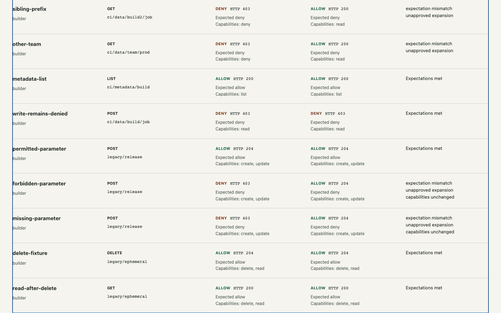

# Same capability, newly allowed request

This directory contains a new, actual offline synthetic run from current main `dc1ea52c8268a9e26f949ecd9b538f427bdf1c0a`, with pinned OpenBao 2.7.0. It does not contact an existing service, change cloud policies or establish complete policy safety.

## The revealing case

`forbidden-parameter` sends the same `POST legacy/release` with synthetic `stage: "prod"` before and after. Both capability probes return `create, update`. Before requires stage and allows only `test`; after removes those parameter restrictions. The real request changes from HTTP 403 (deny) to 204 (allow). The figure excerpts the relevant `stage` input; the complete public body and policy files remain in [inputs/expansion.json](inputs/expansion.json) and [inputs/policies/before.hcl](inputs/policies/before.hcl), [after.hcl](inputs/policies/after.hcl). No internal rule-by-rule authorization trace is claimed.

The complete suite has 11 cases and four expansions. Two expansions retain identical capability lists. [Actual unapproved HTML](expansion/index.html), [JSON](expansion/report.json) and [JUnit](expansion/junit.xml) remain alongside the other configurations:

- [Unchanged](unchanged/index.html): no expansions, exit 0.
- [Matching expectations only](expectations-only/index.html): all expectations match, but four unapproved expansions still produce exit 1.
- [Explicitly approved](approved/index.html): the same observed access and four expansions; `expect.after: allow` plus `allow_expansion: true` on each named expansion produce exit 0.
- [Unavailable runtime](unavailable-runtime/index.html): exit 2 and unattempted observations are `not_run`, never invented denials.

The four expansions are still visible when approved. Approval changes suite classification, not the OpenBao observations. Only HTTP 403 counts as deny; other request failures remain errors. HTML/JSON/JUnit come from the same actual run; no report fields or outcomes were retouched.

## Reopen the portable evidence

After extracting the worked archive, run `python3 -I -B reopen.py`. Python 3.11+ standard library is sufficient. It verifies every file in MANIFEST.json, independently reclassifies the stored report through the included exact current source, checks JUnit outcomes, and verifies the selected before/after observations across approval configurations. This recorded-evidence route does not run OpenBao or authenticate the unsigned archive's origin.

The [figure manifest](figure-manifest.json), [desktop source HTML](request.html), [phone source HTML](request-mobile.html), [SVG](request.svg), [phone SVG](request-mobile.svg) and [generator](figure.py) are included. All relative reader routes in this guide exist in both repository directory and extracted archive. Obtain the worked ZIP through the repository's root README; this extracted guide does not depend on a second copy of its own archive.

For an actual fresh run, use the exact external OpenBao 2.7.0 binary, not a production service. `runtime.json` records the pinned official archive SHA, actual binary SHA and observed version. The binary is external and deliberately not bundled. Its original MPL-2.0 LICENSE is retained as OPENBAO-LICENSE.txt; PolicyDelta's separate MIT source/license remains explicit.

```sh
python3 -I -B reopen.py --bao /absolute/path/to/verified/bao
```

This optional route runs the included frozen current engine from `runtime/`, on the bundled synthetic unchanged suite, in a fresh temporary output directory; it compares actual case observations to the recorded unchanged run. It creates only owned disposable loopback dev servers and requests normal cleanup. This exact extracted route was exercised. Keep paths synthetic: official reports omit request bodies, returned values and tokens, but case names and paths remain visible.

## Error and interruption controls

The actual CLI refused an existing output without changing its three files. Malformed JSON produced no new output directory. The missing binary generated an incomplete report with all 11 cases not run and an engine-version failure. Existing inputs and records were retained.

The [fault-injection record](incomplete-check.json) and [fault reports](incomplete/) separately cover startup after one revision, interruption during a case, and post-cleanup failure, using actual owned OpenBao processes. These are deliberate injections, not naturally occurring incidents. Every owned process stopped; completed observations were retained, interrupted observations were marked incomplete, and unattempted observations remained not run. No token or synthetic returned-value payload was included in generated reports.

## Actual report on desktop and phone

<picture>
  <source media="(max-width: 600px)" srcset="report-mobile.png">
  
</picture>

Both views operate without JavaScript. Phone has a locally scrollable comparison table, keyboard ArrowRight pans it, and the document itself fits 375 pixels. Input identities disclose with native details; JSON remains exact. No new usability defect was demonstrated, so CLI, report renderer, expert table and machine interfaces remain unchanged. Existing historical/current report captures and data remain separate in the root README.
